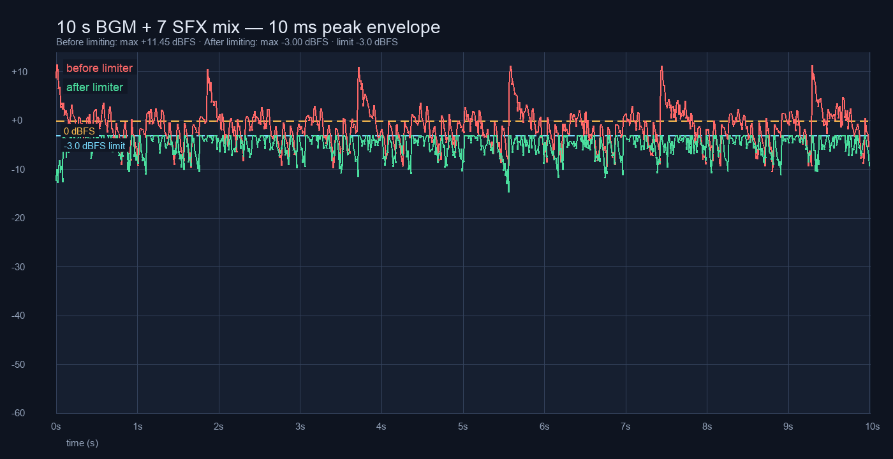

# 音频混音总线：Master + BGM/SFX/Button 与 -3 dBFS 峰值限制器

把原来直接输出到 `Master` 的三层声音收进总线结构：`Master` 下挂 `BGM`、`SFX`、`Button`
三条子总线，默认线性增益分别为 0.55 / 0.80 / 0.70，全部集中在
[`src/ui/components/audio_mix.gd`](../../../src/ui/components/audio_mix.gd) 的 `CONFIG`；
`Master` 末端挂 `AudioEffectHardLimiter`，`ceiling_db = -3.0`。

本轮没有新增外部/二进制音频文件，没有改动设置页布局与三个开关的行为，也没有改 UI。

## 口径

- 基线：`e36fa13`（PR #25 合并后的 main）。
- 改动后：本分支 `agent/audio-mix-bus-f3423068c58f`。
- 运行环境：Godot `4.7.2.stable`（`ed1daf0bf`），macOS Apple M1，headless。
- 10 秒捕获场景：真实 `stage_1_1` 战斗场景（`main.tscn` → `switch_scene("battle")`），
  seed `20261109`；BGM 由场景的 `BattleBgm` 起播战斗轨道，七种战斗音效由场景的
  `BattleSfx` 触发，没有第二套音频层。
- 固定战局基线：只用 `stage_db` / `battle_manager` 等受保护模块生成，不引用任何音频代码。

## 总线与限制器

| 总线 | 父总线 | 默认线性 | 写入 AudioServer | 承载 |
| --- | --- | --- | --- | --- |
| `Master` | —（索引 0） | 1.00 | `0.00 dB` | 最终输出 + 峰值限制器 |
| `BGM` | `Master` | 0.55 | `-5.19 dB` | `BattleBgm` 唯一播放器 |
| `SFX` | `Master` | 0.80 | `-1.94 dB` | 战斗音效 + 连锁音效 |
| `Button` | `Master` | 0.70 | `-3.10 dB` | `button_click`（战斗外按钮/战斗内暂停面板） |

- 默认值只在 `AudioMix.CONFIG` 出现一次；播放器只引用 `AudioMix.BGM_BUS` /
  `SFX_BUS` / `BUTTON_BUS`，不硬编码 0.55 / 0.80 / 0.70。
- `AudioMix.ensure_buses()` 幂等；总线在第一次创建播放器前装好，场景切换后保留。
- 限制器：`AudioEffectHardLimiter`，`ceiling_db = -3.0`，`release = 0.1`，
  `pre_gain_db = 0.0`；`AudioMix.max_peak_linear() = 0.707946`。
- 限制器只作用于 `Master`，三条子总线各自仍按配置电平输出，不会因为限制器互相压音量。

## 10 秒 BGM + 七音混合 PCM

`audio_mix_bus_test.gd --evidence=...` 在真实 `stage_1_1` 战斗场景上：

1. 场景 BGM 起播后，每 100 ms 轮换一种战斗音效（七种循环）；
2. 每 2 秒把七种音效塞进同一帧，制造多音同时触发的叠加峰值；
3. 连续捕获 `Master` 输出 10 秒，采样率 44100 Hz，取左声道导出 16-bit 单声道 PCM；
4. 同一场景分别在「摘掉限制器」与「安装限制器」下各跑一次，得到限制前后两条曲线。

| 指标 | 限制前 | 限制后 |
| --- | --- | --- |
| 捕获帧数 | `441000`（10.000 s） | `441000`（10.000 s） |
| 原始浮点峰值 | `3.735629` | `0.707961` |
| 原始峰值 dBFS | `+11.45 dBFS` | `-3.00 dBFS` |
| 超出 1.0 的样本数 | `7598` | `0` |
| 导出 16-bit 最大样本 | `32767`（削波到 0 dBFS） | `23197` |
| 导出 PCM 最大线性值 | `1.000000`（削波） | `0.707938` |
| 验收线 `|x| <= 0.708` | 不通过（需要限制器） | **通过，逐样本成立** |

限制前 WAV 按 16-bit 导出时会削到 0 dBFS，所以前表的原始峰值取总线浮点值；
逐样本上限看的是限制后的 `mix_after_limiter.wav`：441000 个样本中最大为 `23197`，
`23197 / 32767 = 0.707938 <= 0.708`，峰值 `-3.00 dBFS`。



红色为限制前、绿色为限制后；虚线为 0 dBFS 与 -3 dBFS。图中约 +11 dBFS 的尖峰对应每 2 秒一次的七音同帧叠加；限制后被压到 -3 dBFS，并在释放段回落到 BGM/SFX 各自电平。

原始文件：

- [mix_before_limiter.wav](mix_before_limiter.wav)：限制前，16-bit 单声道 44100 Hz，10 s（削波段）。
- [mix_after_limiter.wav](mix_after_limiter.wav)：限制后，16-bit 单声道 44100 Hz，10 s。
- [peak_before.csv](peak_before.csv) / [peak_after.csv](peak_after.csv)：每 10 ms 峰值。
- [peak_summary.txt](peak_summary.txt)：上表数字的机器可读版本。

独立复核 WAV：

```bash
python3 - <<'PY'
import math, struct, wave
with wave.open("docs/evidence/audio_mix_bus/mix_after_limiter.wav", "rb") as w:
    n, rate = w.getnframes(), w.getframerate()
    samples = struct.unpack(f"<{n}h", w.readframes(n))
peak = max(abs(v) for v in samples)
print(n, rate, peak, peak / 32767, 20 * math.log10(peak / 32767))
PY
```

输出：

```text
441000 44100 23197 0.707938 -3.000
```

## 开关隔离

`audio_mix_bus_test` 断言（完整输出见 [test_output.txt](test_output.txt)）：

| 状态 | `BattleBgm` 播放器 | `BattleSfx` 播放器 | 总线电平 | Master 限制器 |
| --- | --- | --- | --- | --- |
| `musicOn=true, soundOn=true` | 1，播放中 | 按需创建，最多 8 | 0.55 / 0.80 / 0.70 | 1 个 |
| `soundOn=false` | 1，继续播放 | 0 | 不变 | 1 个 |
| `musicOn=false` | 0 | 继续可播 | 不变 | 1 个 |
| 两层都关 | 0 | 0 | 不变 | 1 个 |

- 关掉任一层只释放该层播放器；另外一层的播放器数与播放状态不变。
- 三条总线在开关前后 `volume_db` 逐位相同，没有用「把总线拉到 -80 dB」的假静音。
- 设置页代码（音效/音乐/震动三开关）本轮零 diff；`ui_button_sfx_test`、`vibration_feedback_test`
  等原回归通过。

## 固定种子战斗日志与结算 JSON 与 e36fa13 逐位一致

基线生成器 [`tests/audio_mix_bus_battle_baseline.gd`](../../../tests/audio_mix_bus_battle_baseline.gd)
只调用 `src/data/stage_db.gd` 与受保护战斗模块，在 `e36fa13` 上生成
[`tests/fixtures/audio_mix_bus_battle_baseline.json`](../../../tests/fixtures/audio_mix_bus_battle_baseline.json)：
`stage_1_1`、seed `20261109`、5 级三伙伴、20 回合脚本。

`audio_mix_bus_test` 在四种音频开关状态（off/off、music/silent、sfx/silent、on/on）下
用同一战局重跑，战斗日志与结算 JSON 全部与基线逐字节相同：

```text
sha256=215611ff244f190f84f7b4bedeab6b01f004305f549a95f52b64177a5bbd50dc
bytes=17359
off/off = music/silent = sfx/silent = on/on = baseline
```

原始文件：

- [battle_baseline_e36fa13.json](battle_baseline_e36fa13.json)
- [battle_after_on.json](battle_after_on.json)（on/on 状态）
- [battle_compare.txt](battle_compare.txt)

`cmp` 复核：

```text
$ cmp tests/fixtures/audio_mix_bus_battle_baseline.json docs/evidence/audio_mix_bus/battle_after_on.json
(no output = identical)
```

音效开启时实际触发 8 次（暴击/命中/受击回调），关闭时 0 次；BGM 的合成过程不消耗全局随机数，
所以四种状态的战斗结果不变。

另用 `e36fa13` 已存在的 [`tests/prepare_matchup_transcript.gd`](../../../tests/prepare_matchup_transcript.gd)
重跑其既有固定战局，输出与仓库内 `tests/fixtures/prepare_matchup_battle_baseline.json` 完全相同：

```text
sha256=0d6d3c718332bd2a09e2bf44b9f1116d23d6fd962216cc3fa77fb93153490adb
```

## 受保护文件

相对 `e36fa13` 的 diff 为 0：

- `src/data`
- `src/battle/damage_calculator.gd`
- `src/battle/enemy_attack_modes.gd`
- `src/battle/battle_manager.gd`
- `tests/combat_balance_test.gd`

原始输出：[protected_files_diff.txt](protected_files_diff.txt)。

## 复现

```bash
GODOT=~/Applications/Godot.app/Contents/MacOS/Godot

# 新回归（音频开关、路由、固定战局、10 秒 PCM/峰值断言）
$GODOT --headless --path . --script res://tests/audio_mix_bus_test.gd

# 证据采集（真实 stage_1_1 场景 + 两次 10 秒实时捕获；约 3–4 分钟）
$GODOT --headless --path . --script res://tests/audio_mix_bus_test.gd \
  -- --evidence=docs/evidence/audio_mix_bus

# 峰值曲线图
python3 tools/plot_peak_curves.py \
  --before docs/evidence/audio_mix_bus/peak_before.csv \
  --after docs/evidence/audio_mix_bus/peak_after.csv \
  --output docs/evidence/audio_mix_bus/peak_curves.png

# 基线战局（可在 e36fa13 上重跑，只使用受保护战斗模块）
$GODOT --headless --path . --script res://tests/audio_mix_bus_battle_baseline.gd \
  -- --output=tests/fixtures/audio_mix_bus_battle_baseline.json
```

本轮本地 headless 回归：新回归 + `battle_bgm_test`、`battle_sfx_test`、`lobby_result_bgm_test`、
`ui_button_sfx_test`、`vibration_feedback_test`、`battle_pause_test`、`battle_item_use_test`、
`combat_balance_test`、`boss_break_test`、`stun_order_test`、`battle_rules_test`、
`battle_gui_scene_test`、`battle_prepare_result_gui_scene_test`、`battle_result_stats_test`、
`battle_input_test`、`battle_hit_reaction_test`、`battle_presentation_test`、`combo_chain_test`、
`damage_numbers_test`、`match_hit_feedback_test`、`main_lobby_scene_test`、
`stage_select_gui_scene_test`、`inventory_gui_scene_test`、`shop_gui_scene_test`、
`album_gui_scene_test`、`ranch_gui_scene_test`、`ranch_evolve_gui_test`、
`stage_select_reward_ui_test`、`team_ui_polish_test`、`prepare_matchup_test`、
`chapter_mechanic_test`、`p1_ch1_slice_test`、`stage_progress_loop_test`、
`capture_feedback_test`、`capture_auto_item_test`、`p0_smoke_test`、`p0_contract_test` 等均 exit 0。

两个与本改动无关的环境项：

- `battle_speed_test` 的既有时间断言（`0.2 s` 计时器在 2× 下约 `100 ms` 内结束）在本机
  headless 上实际 `33 ms`；在 `e36fa13` 基线（临时还原三处音频接线）上同样失败，非本改动引入。
- `presentation_settings_restart_test` 需要按 `MATCH3_SAVE_PATH` 分 `--phase=write` /
  `--phase=read` 两段运行；按该口径执行后两段均 exit 0，单段运行会因没有预置存档而失败。

## 限制

- headless 使用 dummy 音频驱动；只能验证 PCM、峰值、路由与播放器生命周期，不能试听音色。
- 捕获是实时运行，峰值样本位置每次可能略有不同；`|x| <= 0.708` 与 -3 dBFS 的界不变。
- 限制前 WAV 是 16-bit 导出，超过 1.0 的样本会削到满幅；限制前原始浮点峰值见上表/CSV。
- 本轮没有 UI 视觉改动，因此没有 before/after 页面截图；视觉证据只有限制前后峰值曲线。
