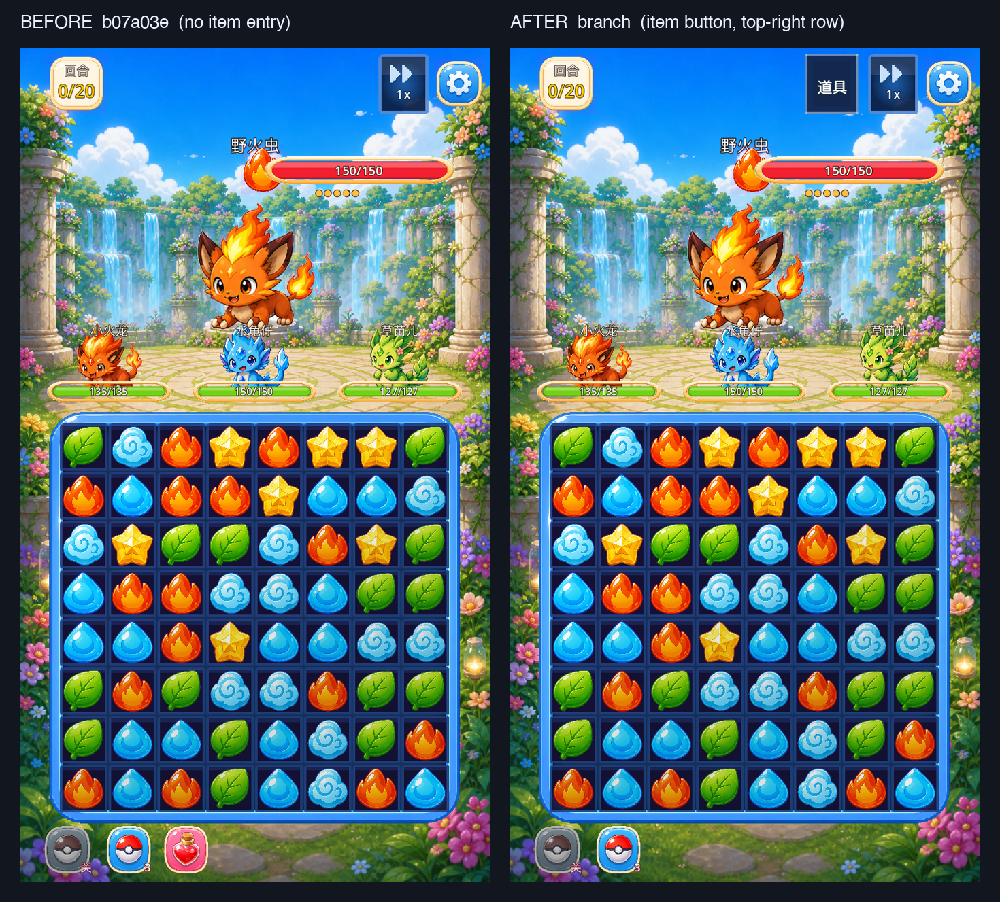
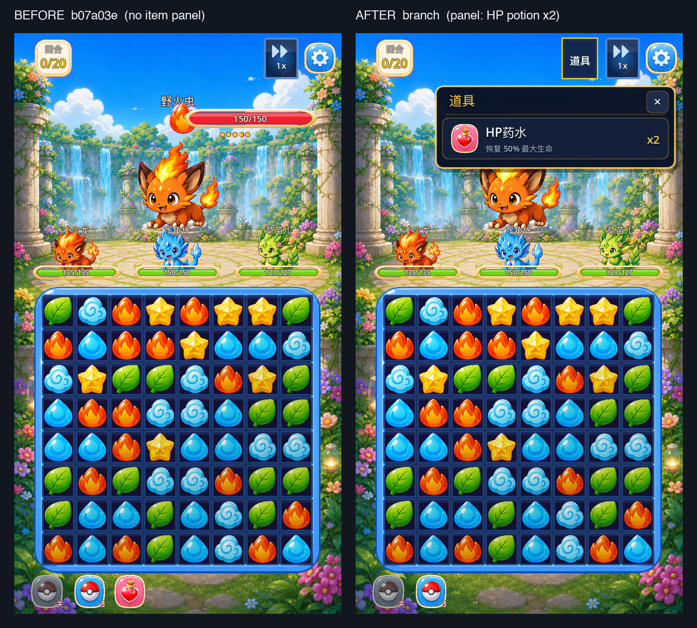
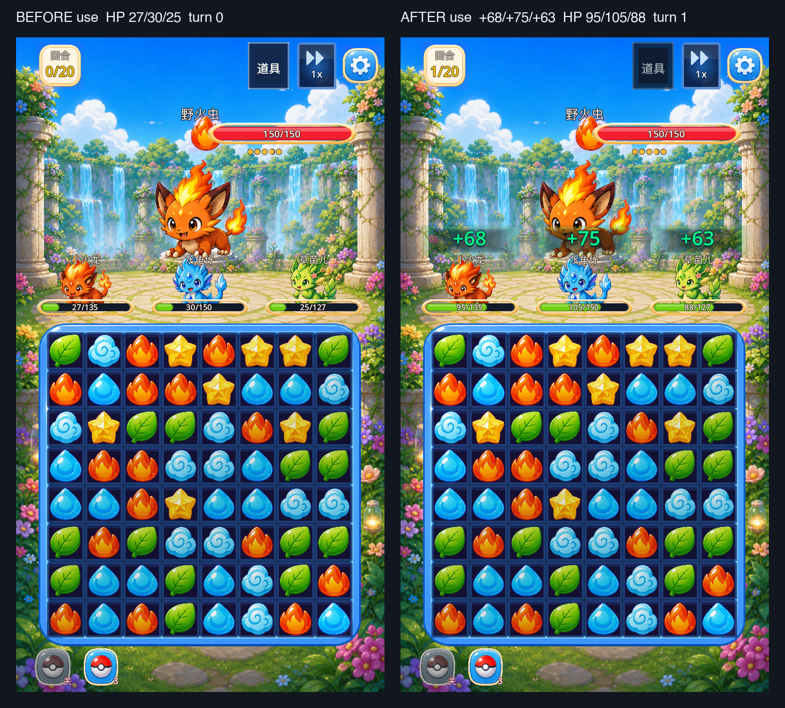

# 战斗内道具使用（HP 药水）

战斗顶栏在倍速 / 设置按钮同一排新增「道具」按钮；点开列出 `item_db` 里
`type="battle"` 的道具（图标、名字、剩余数量），数量 0 的行灰显并标「已用完」。
点一次消耗 1 个，按该道具 `effect.healRatio` 给全体存活伙伴回血（逐人不超过 maxHP），
随后消耗本回合、照常进入敌方回合与前摇。底部捕捉快捷栏不再混入战斗类道具，
避免留下第二条不消耗回合的道具入口；捕捉球快捷栏行为不变。

## 对比口径

- 基线：`b07a03e`（PR #24 合并后的 main）。
- 改动后：`agent/battle-item-use-f261161ba624`。
- 运行环境：Godot `4.7.2.stable`（`ed1daf0bf`），macOS Apple M1。
- 画面：`stage_1_1`、750×1334 窗口（375×667 逻辑视口）、默认主题、同一截图 harness。
- 截图使用同一个临时存档 `/tmp/item_shots/save.cfg`（同一队伍/属性/上限），
  「使用前 / 使用后」两张从同一份 20% 血量状态出发；基线截图在 `b07a03e` worktree
  用同一存档、同一命令（去掉新增开关）生成。
- 数值口径：截图队伍 maxHP `135 / 150 / 127`，存活 maxHP 合计 `412`。

## 画面

| 状态 | 截图 | SHA-256 |
| --- | --- | --- |
| Before：基线 `b07a03e`，无道具入口（底部快捷栏里仍混着 HP 药水） | [before_baseline_battle.png](before_baseline_battle.png) | `a0cb6340…55a5c9d8` |
| After：本分支，顶栏「道具」按钮（倍速/设置同一排） | [after_item_button.png](after_item_button.png) | `a237e0b3…f77ad997` |
| After：道具面板展开，HP 药水 x2 | [after_item_panel.png](after_item_panel.png) | `7caf0ca4…21d12d2` |
| After：数量 0 灰显（x0 / 已用完） | [after_item_panel_zero.png](after_item_panel_zero.png) | `3211b73d…1bca524` |
| Before use：全队压到 20% 血，HP 27/30/25，回合 0 | [before_use_hp.png](before_use_hp.png) | `98df9d63…596eabd` |
| After use：+68/+75/+63，HP 95/105/88，回合 1 | [after_use_hp.png](after_use_hp.png) | `090a4596…0af1025b` |

并排对照（左基线 / 右本分支）：







原始哈希：[screenshot_hashes.txt](screenshot_hashes.txt)。

## 回血口径

- 比例只从 `ItemDB.get_item(id).effect.healRatio` 读取；面板副标题的「恢复 50% 最大生命」
  也从同一份数据计算，没有在代码里写死 `0.5`。
- 只遍历 `hp > 0` 的伙伴；先按 `int(存活 maxHP 之和 × healRatio)` 得到总量，
  再按最大余数分到各伙伴，逐人封顶 `maxHP`。这样整数血量下总量仍与数据比例一致。
- 截图中 `412 × 0.5 = 206`；逐人 `68 + 75 + 63 = 206`，每人都不超过自身 maxHP。
- 使用前先 `SaveManager.use_item(id, 1)` 落盘，再结算回血；数量 0 时直接返回，
  不扣数量、不推进回合、不进入敌方回合。

## 验收逐项

### 1. 全程不用道具：与基线逐字节相同

固定种子转录（`prepare_matchup_transcript.gd`：`stage_1_1`、seed `20261111`、
5 级三伙伴、≤40 回合）与 `b07a03e` 完全一致：

```text
[BattleItem] fixed_seed_transcript sha256=0d6d3c718332bd2a09e2bf44b9f1116d23d6fd962216cc3fa77fb93153490adb baseline=0d6d3c718332bd2a09e2bf44b9f1116d23d6fd962216cc3fa77fb93153490adb bytes=8500
```

场景级「不用道具」整场战斗（real battle scene、seed `20261111`、同一存档、12 回合）
在本分支与 `b07a03e` worktree 各跑一遍，输出 `cmp` 逐字节相同：

```text
$ cmp battle_unused_baseline.json battle_unused.json
cmp: identical
1061a31bdb3186bced90220928d6c0967099491679f68c95e53519311e13885e  battle_unused_baseline.json
1061a31bdb3186bced90220928d6c0967099491679f68c95e53519311e13885e  battle_unused.json
```

原始输出：[transcript_compare.txt](transcript_compare.txt)、[json_compare.txt](json_compare.txt)。
两态战斗 JSON + 结算：[battle_unused.json](battle_unused.json)、
[battle_used.json](battle_used.json)。

### 2. 用 1 个药水：总量、扣数量与落盘

`battle_used.json` 的 `item_use` 实测：

```json
{
  "count_before": 2,
  "count_after": 1,
  "turn_before": 0,
  "turn_after_use": 1,
  "hp_before": [27, 30, 25],
  "hp_after_use": [95, 105, 88],
  "max_hp": [135, 150, 127],
  "living_max_hp_total": 412,
  "heal_total": 206,
  "expected_heal": 206,
  "windup_seen": true,
  "enemy_hits_after_item": 1
}
```

`test_output.txt` 里同一断言在另一份随机队伍上复跑：

```text
[BattleItem] use count=2->1 turn=0->1 heal=207/207 ratio=0.5 windup=true enemy_hits=1
[BattleItem] persisted count=1
```

- 总回血 = `int(存活 maxHP 之和 × 0.5)`，未超过任何伙伴 maxHP；
- 内存数量 `2→1`，并直接读取 `MATCH3_SAVE_PATH` 指向的存档 section `inventory` 验证落盘；
- 重新进战斗后从存档读回数量 1。

### 3. 数量 0 点击：数量 / 回合 / 血量都不变

```text
[BattleItem] zero_count count=0 turn=0 hp=415 state=0 enemy_hits=0 panel_above_board=true
[BattleItem] zero_after_last count=0 turn=1 hp=281 enemy_hits=1
```

两段分别覆盖「开局就是 0」与「用完最后一个后回面板再点」；点击后面板保持打开，
不报错、不触发敌方行动。数量 0 的行截图见 [after_item_panel_zero.png](after_item_panel_zero.png)。

### 4. 道具回合后敌人正常出手一次，回合 +1

`battle_used.json` 的 `turn_after_use=1`、`windup_seen=true`、`enemy_hits_after_item=1`；
`test_output.txt` 的 `use` 与 `speed2x_pause` 两段也分别断言 `windup=true`、`enemy_hits=1`、
回合只 +1。前摇时长沿用既有 `ENEMY_WINDUP_DURATION`，本轮没有改动。

### 5. 2x 倍速与暂停

```text
[BattleItem] speed2x_pause heal=207 turn=1 enemy_hits=1 time_scale=2.00
```

在 2x 下使用药水，回血停顿期间打开暂停：时间尺度冻结为 0，0.6 秒内敌人未出手、
回合与血量不变；继续后恢复 2x，敌人只出手一次，回合只 +1，离开战斗后时间尺度回到 1.0。
倍速参数与暂停浮层均未改动。

## 受保护文件

相对 `b07a03e` 的 diff 为 0：

```text
src/data（含 item_db.gd）
src/battle/damage_calculator.gd
src/battle/enemy_attack_modes.gd
src/battle/battle_manager.gd
tests/combat_balance_test.gd
src/ui/components/battle_sfx.gd
src/ui/components/battle_bgm.gd
src/ui/components/vibration_feedback.gd
src/ui/components/battle_pause_overlay.gd
```

`SPEED_LEVELS` / `DEFAULT_SPEED_LEVEL` / `set_battle_speed` / `toggle_battle_speed` /
`ENEMY_WINDUP_DURATION` 在 `scene_battle.gd` 的 diff 中没有增删行。原始输出：
[protected_files_diff.txt](protected_files_diff.txt)。

## 回归

本轮本地 headless 回归（Godot 4.7.2，逐项退出码）：

```text
battle_item_use_test 0
battle_pause_test 0
battle_input_test 0
battle_gui_scene_test 0
capture_auto_item_test 0
inventory_gui_scene_test 0
battle_rules_test 0
enemy_windup_test 0
battle_sfx_test 0
battle_bgm_test 0
vibration_feedback_test 0
combat_balance_test 0
p0_smoke_test 0
p1_ch1_slice_test 0
stage_progress_loop_test 0
battle_result_stats_test 0
ui_button_sfx_test 0
battle_hit_reaction_test 0
combo_chain_test 0
match_hit_feedback_test 0
boss_break_test 0
stun_order_test 0
presentation_settings_restart_test（write/read 两阶段）0
```

`battle_speed_test` 的墙钟 0.2s 计时器断言失败（本分支 `34.0ms`，基线 `b07a03e` `33.0ms`），
与本轮改动无关；其固定种子 `identical=true`、倍速比例与回合/日志断言均通过。
完整清单与说明见 [regression.txt](regression.txt)。

## 复现

```bash
GODOT=~/Applications/Godot.app/Contents/MacOS/Godot

# 道具/数量/回合/落盘/0 数量/2x+暂停 回归
MATCH3_SAVE_PATH=/tmp/match3_item_test.cfg $GODOT --headless --path . --fixed-fps 60 \
  --script res://tests/battle_item_use_test.gd

# 固定种子转录
$GODOT --headless --path . --script res://tests/prepare_matchup_transcript.gd \
  -- --output=docs/evidence/battle_item_use/transcript_branch.json

# 两态战斗 JSON（先 prepare 固定队伍存档，再复用同一存档）
MATCH3_SAVE_PATH=/tmp/item_evidence/save.cfg $GODOT --headless --path . --fixed-fps 60 \
  --script res://tests/battle_item_evidence.gd -- --prepare=1 --use-item=0 \
  --output=docs/evidence/battle_item_use/battle_unused.json
MATCH3_SAVE_PATH=/tmp/item_evidence/save.cfg $GODOT --headless --path . --fixed-fps 60 \
  --script res://tests/battle_item_evidence.gd -- --use-item=1 \
  --output=docs/evidence/battle_item_use/battle_used.json

# 截图（需要窗口渲染，不能加 --headless）
MATCH3_SAVE_PATH=/tmp/item_shots/save.cfg $GODOT --path . --fixed-fps 60 \
  --script res://tests/capture_runtime_scene.gd -- --scene-name=battle --stage-id=stage_1_1 \
  --hide-toast=1 --battle-inventory=hp_potion:2,capture_ball:3 --battle-item-demo=panel \
  --settle-frames=6 --output=docs/evidence/battle_item_use/after_item_panel.png
```

`capture_runtime_scene.gd` 新增截图开关：`--battle-inventory=id:count,...` 写入背包，
`--battle-item-demo=panel|damaged|use` 展开面板 / 压血 / 压血后使用一次。

## 实现位置

- `src/ui/scene/scene_battle.gd`：道具按钮、面板开合、点击命中、消耗/回血/回合推进、列表数据。
- `src/ui/components/battle_item_panel.gd`：独立子节点绘制列表（高于 HUD、低于暂停浮层）。
- `tests/battle_item_use_test.gd`：本轮回归。
- `tests/battle_item_evidence.gd`：两态战斗 JSON 证据。
- `tests/capture_runtime_scene.gd`：截图 harness 新增道具演示开关。

## 限制

- headless 环境没有真实手感/音频/震动体验，截图只覆盖面板与血量变化；
  音效/震动沿用既有 `button_click` / `button_tap` 事件，没有新增参数。
- 面板打开时位于顶栏下方，会盖住敌方血条区域；按钮本身在棋盘上方，不压棋盘。
- 仓库没有 GitHub Actions 工作流，本轮以本地 headless 输出与截图哈希为准。
