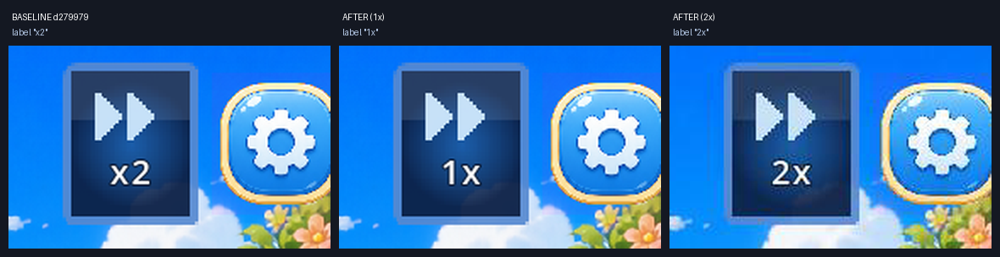

# 战斗内 x2 倍速开关

本轮把战斗顶栏原本只画死 `x2` 的按钮接成可用开关：点击在 `1x` / `2x` 间切换，
按钮文字直接显示当前档位。倍速只改 `Engine.time_scale`，动画、敌方出手前摇、
伤害/治疗飘字停留、波次间隔与结算延迟都按同一时间尺度推进；伤害、承伤、回合数、
随机数逻辑不变。战斗内任意状态（含连锁、下落、敌方回合）均可切档，切档点击被消费，
不会落到棋盘或技能上。

## 对比口径

- 基线：`d279979`（PR #18 合并后的 main）。
- 改动后：`agent/battle-speed-toggle-17717d14a8b4` 分支。
- 运行环境：Godot `4.7.2.stable`，macOS Apple M1。
- 画面口径：`stage_1_1`、750×1334 渲染（375×667 逻辑视口）、默认主题、同一截图 harness。
- 断言口径：`stage_1_1`、seed `20261110`、测试内把本场敌人血量固定为 420，
  按固定扫描顺序落子；1x / 2x 各跑完整一场，比较伤害日志、承伤日志与结算 JSON。
- 真实耗时口径：从战斗场景初始化完成开始，到 `BATTLE_END` 为止的墙钟时间；
  2x 通过 `set_battle_speed(2)` 在开场即切入。

## 按钮前后对比

同一 `stage_1_1` 首屏、同一主题与视口，仅倍速档位不同：



从左到右：基线 `d279979` 固定显示 `x2`；改动后 `1x`；改动后 `2x`。

完整首屏截图：

- 基线 `d279979`：[before_battle.png](before_battle.png)（按钮固定显示 `x2`）
- 改动后 `1x`：[after_1x.png](after_1x.png)（按钮显示 `1x`）
- 改动后 `2x`：[after_2x.png](after_2x.png)（按钮显示 `2x`，取自同一录像的实际运行帧）

受棋盘/角色闲置动画相位影响，整屏逐像素可能有轻微差异；场景、视口、主题、棋盘初始布局一致，按钮局部对比见上。

## 固定种子断言

`test_output.txt` 中的关键输出：

```text
[BattleSpeed] run speed=1x actions=7 turns=7 logs=11/6 result=win duration=19.42s
[BattleSpeed] run speed=2x actions=7 turns=7 logs=11/6 result=win duration=10.01s
[BattleSpeed] fixed_seed=20261110 identical=true
[BattleSpeed] durations 1x=19.42s 2x=10.01s ratio=1.94 turns=7 damage_logs=11 taken_logs=6 result=win
[BattleSpeed] run speed=1x actions=7 turns=7 logs=11/6 result=win duration=10.06s
[BattleSpeed] mid_switch state=2 immediate_0.2s_timer=105.0ms identical=true duration=10.06s (1x=19.42s) turns=7
[BattleSpeed] OK
```

- `identical=true`：同一固定种子下 1x 与 2x 的 `turns`、`damage_dealt_log`、
  `damage_taken_log` 与 `get_battle_result()` 结算 JSON 逐位一致。
- 实测整场耗时：1x `19.42s`，2x `10.01s`，比值 `1.94`（2x 接近一半）。
- 运行中切档从 `MATCHING`（枚举值 2）状态切入 2x；切档后 0.2s 计时器实测
  `105.0ms`，说明时间尺度下一帧立即生效；最终日志/结算仍与纯 1x 一致，
  切档场次回合数 7、每一次有效交换只推进 1 回合，没有重复结算。
- 固定种子为 `20261110`；测试脚本只改本场敌人血量作为测试口径，不改数据表。

## 录像

- [battle_1x.mp4](battle_1x.mp4)：整场 1x，409 帧 @30fps，13.63s，按钮显示 `1x`。
- [battle_2x.mp4](battle_2x.mp4)：开场点击按钮切到 2x，228 帧 @30fps，7.60s，按钮显示 `2x`。
- 两段录像同种子、同关卡、同落子顺序；2x 录像里可以看到按钮从 `1x` 变为 `2x`。
- 录像用 Godot Movie Maker 固定 30fps 采集（见 `recordings.txt`）。视频时长比值
  低于 headless 的 1.94，是因为录像包含固定开场/收尾等待与 30fps 下每次计时器
  至少一帧的量化开销；真实耗时以 headless 断言为准。

## 四条平衡线

`balance_lines_before.txt`（`d279979`）与 `balance_lines_after.txt`（本分支）逐字节一致
（`diff -q` 无输出）。覆盖：

- `combat_balance_test`
- `boss_break_test`
- `stun_order_test`
- `battle_rules_test`

四条平衡线输出未变，伤害/承伤/回合数/破招/眩晕数值均与基线相同。

## 约束核对

- `src/data`、棋盘 `src/match3/board.gd`、战斗数据表零 diff。
- `battle_sfx.gd` / `battle_bgm.gd` / `vibration_feedback.gd` 的参数零 diff。
- 只改时间尺度；战斗逻辑随机数调用顺序不变。表现层粒子/震屏改用独立
  `_fx_rng`，避免帧数变化把视觉随机数插进战斗随机序列，从而保证 1x/2x 的
  伤害日志与结算逐位一致。
- 离开战斗在 `_exit_tree` 恢复 `Engine.time_scale = 1.0`，不影响大厅/结算。

## 测试

```bash
GODOT=~/Applications/Godot.app/Contents/MacOS/Godot

# 本轮新增回归（含 identical=true 与两段耗时）
$GODOT --headless --path . --script res://tests/battle_speed_test.gd

# 录像驱动（需要显示环境）
$GODOT --path . --write-movie /tmp/battle_speed_1x.avi --fixed-fps 30 \
  --script res://tests/battle_speed_demo.gd -- --speed-level=1
$GODOT --path . --write-movie /tmp/battle_speed_2x.avi --fixed-fps 30 \
  --script res://tests/battle_speed_demo.gd -- --speed-level=2

# 四条平衡线（基线与本分支分别运行后 diff）
$GODOT --headless --path . --script res://tests/combat_balance_test.gd
$GODOT --headless --path . --script res://tests/boss_break_test.gd
$GODOT --headless --path . --script res://tests/stun_order_test.gd
$GODOT --headless --path . --script res://tests/battle_rules_test.gd
```

本轮跑过的回归（全部 exit 0）：

`battle_speed_test`、`combat_balance_test`、`boss_break_test`、`stun_order_test`、
`battle_rules_test`、`p0_contract_test`、`p0_smoke_test`、`battle_bgm_test`、`battle_sfx_test`、
`battle_gui_scene_test`、`battle_prepare_result_gui_scene_test`、`battle_input_test`、
`battle_result_stats_test`、`active_skill_test`、`main_lobby_scene_test`、`start_gui_scene_test`、
`stage_select_gui_scene_test`、`inventory_gui_scene_test`、`shop_gui_scene_test`、
`ranch_gui_scene_test`、`album_gui_scene_test`、`stage_progress_loop_test`、`damage_numbers_test`、
`combo_chain_test`、`enemy_attack_modes_test`、`enemy_windup_test`、`enemy_intent_test`、
`wave_entry_test`、`p1_ch1_slice_test`、`chapter_mechanic_test`、`battle_hit_reaction_test`、
`team_transition_test`、`tutorial_flow_test`、`team_ui_polish_test`、`capture_auto_item_test`、
`reward_rules_test`、`match_hit_feedback_test`、`vibration_feedback_test`。
