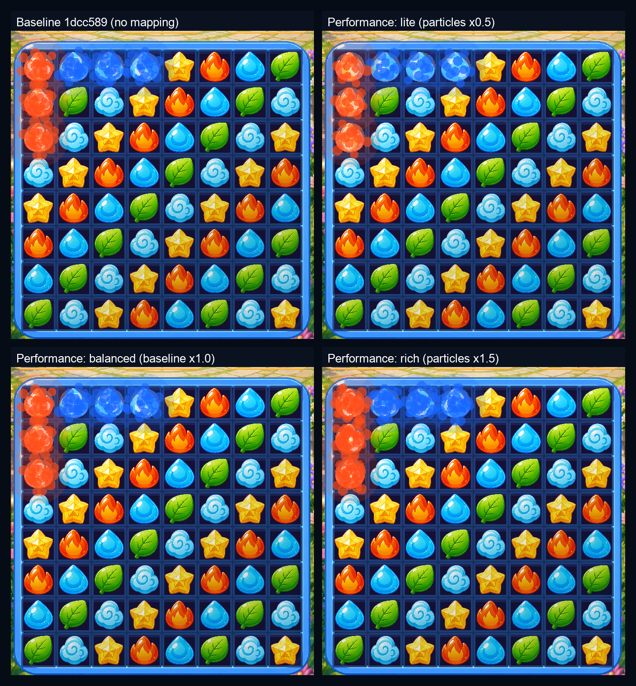
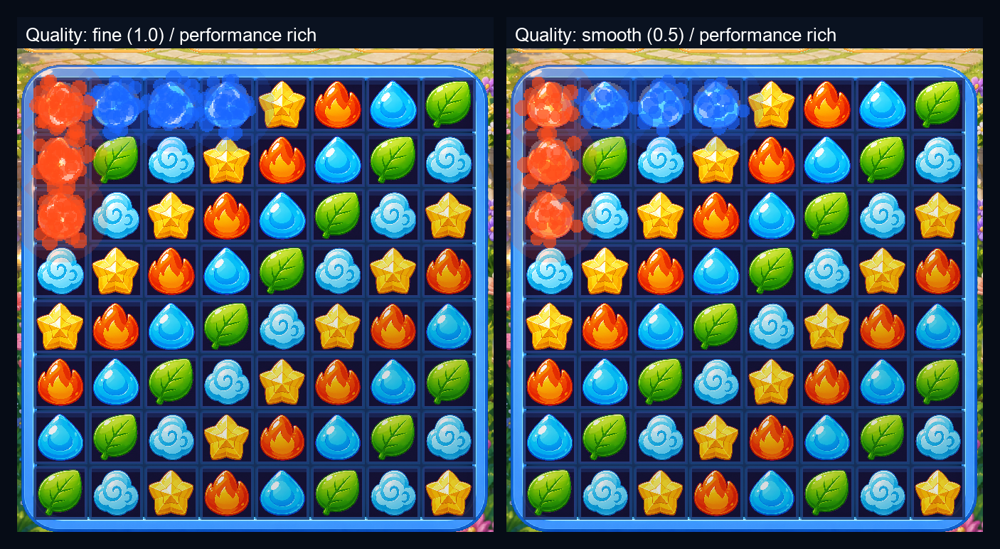

# 画质等级 / 战斗表现：两个设置开关接通真实表现

设置页原本只写存档的「画质等级」（流畅 / 标准 / 精细）与「战斗表现」（轻量 / 均衡 / 华丽）
现在由 `src/ui/components/presentation_profile.gd` 集中映射成战斗表现参数：

- **战斗表现**：粒子倍率、震屏倍率与震屏上限、飘字错峰层数；
- **画质等级**：特效密度倍率，与战斗表现的粒子倍率相乘。

战斗场景每帧重新读取设置，运行中切档下一帧生效；映射不保存任何运行时全局状态，
离开战斗后不会把档位带进大厅。所有档位都不新增常驻节点。

## 对比口径

- 基线：`1dcc589`（PR #19 合并后的 main）。
- 改动后：`agent/wire-quality-settings-711dad8eb586` 分支。
- 运行环境：Godot `4.7.2.stable`，macOS Apple M1。
- 画面口径：`stage_1_1`、750×1334 渲染（375×667 逻辑视口）、默认主题、同一截图 harness。
- 截图口径：seed `20261110`，同一棋盘、同一交换 `(0,0)↔(0,1)`，交换后固定 4 个引擎进程帧
  截取；只切换战斗表现档位（画质固定精细）。
- 数值口径：`stage_1_1`、seed `20261110`，测试内把本场敌人血量固定为 420（仅测试口径，
  不改数据表），按固定扫描顺序落子；三档各跑完整一场。
- 粒子峰值口径：每帧统计 `_gem_particles`、`_obstacle_particles`、`_defeat_explosions`、
  `_victory_particles` 的存活总数，取整场（含结算后 45 帧胜利粒子）最大值。
- 震屏最大位移口径：每帧取 `|攻击震屏 x|` 与 `|棋盘震屏 + 命中震屏|` 的较大值，取整场最大值。

## 中央映射

| 档位 | 值 | 粒子倍率 | 震屏倍率 | 震屏上限 | 飘字层数 |
|---|---|---|---|---|---|
| 战斗表现·轻量 | `lite` | 0.5 | 0.5 | 5px | 1 |
| 战斗表现·均衡 | `balanced` | 1.0 | 1.0 | 10px | 3 |
| 战斗表现·华丽 | `rich` | 1.5 | 1.25 | 12px | 3 |

| 档位 | 值 | 特效密度 |
|---|---|---|
| 画质·流畅 | `low` | 0.5 |
| 画质·标准 | `medium` | 0.75 |
| 画质·精细 | `high` | 1.0 |

均衡档与精细画质保持接通前的基准表现；轻量档的粒子与震屏都减半，飘字只保留 1 层；
华丽档粒子更多、震屏略强。粒子数按 `floor(基准 × 画质密度 × 表现粒子倍率)` 缩放，
至少保留 1 粒。

接入点：

- 粒子：命中爆散、普通消除、障碍破坏、敌人倒下、胜利粒子；
- 震屏：攻击震屏、棋盘大量消除震屏、命中震屏、受击头像抖动；
- 飘字：同目标多段伤害的错峰层数；
- 画质密度：作用于上述全部粒子数量。

## 三档同帧截图



从左到右 / 从上到下：基线 `1dcc589`、轻量、均衡、华丽。轻量与华丽在同一帧的粒子密度差异
可以直接看到；均衡与基线逐像素一致（`before_battle.png` 对比 `after_balanced.png` 的
PIL 像素差 `bbox=None`）。

完整截图：

- [before_battle.png](before_battle.png)：基线 `1dcc589`
- [after_lite.png](after_lite.png)：轻量
- [after_balanced.png](after_balanced.png)：均衡
- [after_rich.png](after_rich.png)：华丽
- [after_quality_low.png](after_quality_low.png)：流畅画质 × 华丽表现

画质对照：



## 实测数字

固定种子 `20261110`、`stage_1_1` 整场：

| 档位 | 粒子峰值 | 最大震屏位移 |
|---|---:|---:|
| 轻量 `lite` | 66 | 3.75px |
| 均衡 `balanced` | 138 | 7.50px |
| 华丽 `rich` | 204 | 9.38px |

- 粒子峰值：轻量 / 华丽 = `66 / 204 = 0.324`，不超过一半；
- 震屏最大位移：轻量 / 华丽 = `3.75 / 9.38 = 0.400`，不超过一半；
- 飘字错峰层数：轻量 1，均衡 / 华丽 3。

三档 `damage_dealt` 日志、`damage_taken` 日志与结算 JSON 逐位一致（`identical=true`）：
`turns=7`、伤害日志 10 条、承伤日志 6 条、`result=win`。

画质对照（战斗表现固定华丽）：

| 画质 | 粒子峰值 |
|---|---:|
| 流畅 `low` | 102 |
| 精细 `high` | 204 |

`102 / 204 = 0.5`，且两场战斗日志与结算 JSON 逐位一致（`identical=true`）。

原始输出见 [test_output.txt](test_output.txt)。

## 下一帧生效 / 不新增节点 / 大厅不继承

同一次运行中把战斗表现从均衡切到轻量，`await process_frame` 后：

- 战斗内解析到的档位变为 `lite`，震屏倍率减半；
- 同一基准的粒子数 `8 → 4`；
- 战斗场景节点数 `87 → 87`，最低档不新增常驻节点；
- 回到大厅后当前场景为 `main`，战斗场景已释放，`Engine.time_scale=1.0`，
  大厅背景粒子保持固定 18 粒，不随战斗表现档位变化。

## 重启进程后从存档恢复

两个独立进程、同一个 `MATCH3_SAVE_PATH`：

```text
[PresentationRestart] write path=/tmp/match3_presentation_restart_final.cfg quality=low performance=rich soundOn=false musicOn=false vibrationOn=false
[PresentationRestart] OK
[PresentationRestart] read path=/tmp/match3_presentation_restart_final.cfg quality=low performance=rich
[PresentationRestart] battle profile quality=low performance=rich particle_density=0.75 shake_scale=1.25 popup_layers=3
[PresentationRestart] OK
```

第二个进程重新加载存档并进入战斗，两个档位都恢复到写入值，组合参数（0.5 × 1.5 = 0.75）
也正确。原始输出：[restart_write.txt](restart_write.txt)、[restart_read.txt](restart_read.txt)。

## 约束核对

- 生产代码只改 `src/ui/scene/scene_battle.gd`、`src/ui/components/battle_animation_controller.gd`，
  新增 `src/ui/components/presentation_profile.gd`；`src/data`、`src/battle/damage_calculator.gd`、
  `src/battle/enemy_attack_modes.gd`、`src/battle/battle_manager.gd` 零 diff。
- 四条平衡线在基线与本分支分别运行后逐行 diff 一致：
  `combat_balance_test`、`boss_break_test`、`stun_order_test`、`battle_rules_test`。
  原始输出：[balance_lines_before.txt](balance_lines_before.txt)、
  [balance_lines_after.txt](balance_lines_after.txt)。
- 表现层粒子/震屏继续使用独立 `_fx_rng`；档位只改粒子数量、震屏幅度与飘字层数，
  不触碰伤害、承伤、回合或战斗随机序列。

## 复现命令

```bash
GODOT=~/Applications/Godot.app/Contents/MacOS/Godot

# 三档整场断言 + 测量
rm -f /tmp/match3_presentation_final.cfg
MATCH3_SAVE_PATH=/tmp/match3_presentation_final.cfg \
  $GODOT --headless --path . --script res://tests/battle_presentation_test.gd

# 跨进程恢复（两条命令，使用同一存档路径）
rm -f /tmp/match3_presentation_restart_final.cfg
MATCH3_SAVE_PATH=/tmp/match3_presentation_restart_final.cfg \
  $GODOT --headless --path . --script res://tests/presentation_settings_restart_test.gd -- --phase=write
MATCH3_SAVE_PATH=/tmp/match3_presentation_restart_final.cfg \
  $GODOT --headless --path . --script res://tests/presentation_settings_restart_test.gd -- --phase=read

# 三档同帧截图（窗口渲染）
for mode in lite balanced rich; do
  $GODOT --path . --fixed-fps 60 \
    --script res://tests/battle_presentation_capture.gd -- \
    --quality-level=high --performance-mode=$mode --frames-after=4 \
    --output=docs/evidence/presentation_settings/after_$mode.png
done
```

## 本轮跑过的回归（全部 exit 0）

`battle_presentation_test`、`presentation_settings_restart_test`、`combat_balance_test`、
`boss_break_test`、`stun_order_test`、`battle_rules_test`、`damage_numbers_test`、
`match_hit_feedback_test`、`battle_hit_reaction_test`、`battle_speed_test`、
`battle_gui_scene_test`、`battle_prepare_result_gui_scene_test`、`main_lobby_scene_test`、
`battle_sfx_test`、`battle_bgm_test`、`vibration_feedback_test`、`capture_auto_item_test`、
`p0_contract_test`、`p0_smoke_test`、`battle_input_test`、`battle_result_stats_test`、
`p1_ch1_slice_test`、`stage_progress_loop_test`、`wave_entry_test`、`enemy_attack_modes_test`、
`enemy_windup_test`、`enemy_intent_test`、`combo_chain_test`、`active_skill_test`、
`reward_rules_test`、`chapter_mechanic_test`、`team_transition_test`、`tutorial_flow_test`。
