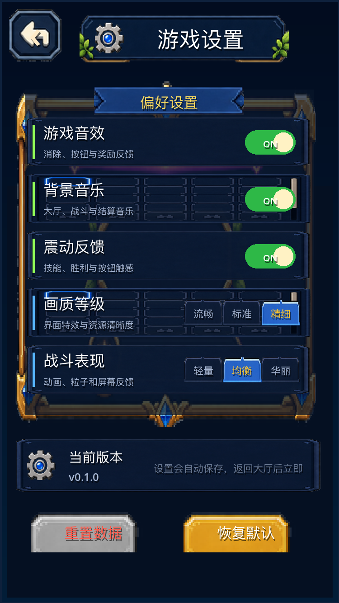
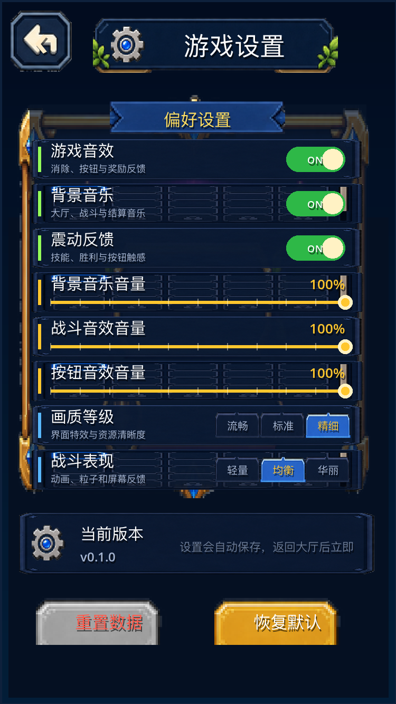
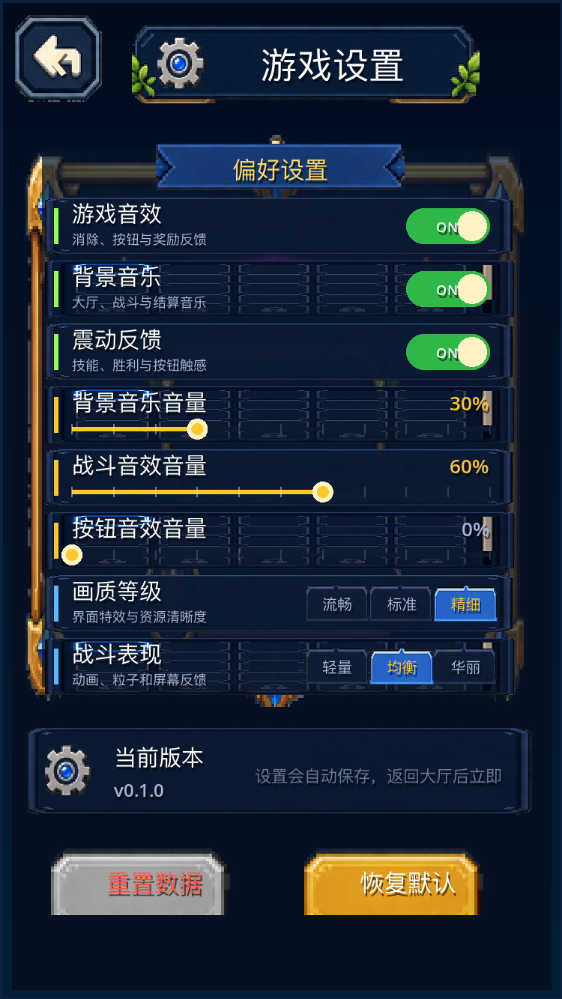

# 设置页音量滑块：BGM / 音效 / 按钮

在设置页加入三条 0–100%、步长 10%、默认 100% 的音量滑块。滑块值作为倍率乘在
既有 BGM / SFX / Button 子总线基准 0.55 / 0.80 / 0.70 上，实时写 AudioServer；
三个值以 `bgmVolume` / `sfxVolume` / `buttonVolume` 写入 `settings` 存档并跨进程恢复。
Master 的总线与 -3.0 dBFS 限制器、以及所有受保护数值路径都没有改动。

## 口径

- 基线：`2f50f09`（PR #26 合并后的 main）。
- 改动后：`agent/volume-sliders-5244588df69f`。
- 运行环境：Godot `4.7.2.stable`（`ed1daf0bf`），macOS Apple M1。
- 截图使用独立空存档（`MATCH3_SAVE_PATH=/tmp/capture_*.cfg`），同一 750×1334 视口、
  同一 `--fixed-fps 60`、同一设置页默认状态；before 在 `2f50f09` 工作树采集。
- headless 使用 dummy 音频驱动；本轮验证总线 dB / mute、存档、固定战局与限制器参数，
  不判定听感。

## 变化

| 滑块 | 存档键 | 映射总线 | 基准线性增益（不变） |
| --- | --- | --- | --- |
| 背景音乐音量 | `bgmVolume` | `BGM` | `0.55` |
| 战斗音效音量 | `sfxVolume` | `SFX` | `0.80` |
| 按钮音效音量 | `buttonVolume` | `Button` | `0.70` |

- 有效增益 = 基准 × 滑块百分比 / 100，再换算 dB 写入 `AudioServer.set_bus_volume_db`。
- 100% 时走 `linear_to_db(基准)`，与 `2f50f09` 的写入值逐位相同。
- 0% 时只把该子总线 `set_bus_mute(true)`；另外两条总线的 dB 与 mute 都不变。
- 滑块拖动按 10% 吸附；点击轨道任意位置也会立即生效，并随拖动实时更新。
- 存档读取在设置页初始化时应用；即使不打开设置页，BGM/SFX/Button 首次创建播放器时
  `AudioMix.ensure_buses()` 也会从 SaveManager 恢复三条总线值。

## 总线实测：0–100% 每个档位

完整原始表：[bus_levels.csv](bus_levels.csv)（33 行 = 3 条总线 × 11 个档位）。
`others_unchanged` 列在每一行都是 `true`：调一条滑块时另外两条总线的 dB 与 mute
逐位不变。

`100%`（与 `2f50f09` 相同）：

| 总线 | `volume_db` | mute |
| --- | --- | --- |
| `BGM` | `-5.192746162` | `false` |
| `SFX` | `-1.938200235` | `false` |
| `Button` | `-3.098039150` | `false` |

`50%`：

| 总线 | `volume_db` | mute |
| --- | --- | --- |
| `BGM` | `-11.213346481` | `false` |
| `SFX` | `-7.958800316` | `false` |
| `Button` | `-9.118638992` | `false` |

`0%`：

| 总线 | `volume_db` | mute | 另外两层 |
| --- | --- | --- | --- |
| `BGM` | `-5.192746162`（保持基准） | `true` | dB / mute 不变 |
| `SFX` | `-1.938200235`（保持基准） | `true` | dB / mute 不变 |
| `Button` | `-3.098039150`（保持基准） | `true` | dB / mute 不变 |

0% 采用总线 mute 而不是把 dB 拉到 `-inf`：只静音该层，且其它层的电平完全不动。

## 滑块步进与 UI 命中断言

- `normalize_percent`：`-20 → 0`、`120 → 100`、`33 → 30`、`38 → 40`、`47 → 50`、
  字符串 `"70" → 70`。
- 3 条滑块行 `type=slider`、`default=100`、`min=0`、`max=100`、`step=10`，
  对应三个新键。
- 测试按轨道坐标点击/拖动：最左写入 0、中点写入 50、最右写入 100；连续拖到 33% 得 30、
  拖到 99% 得 100。

## 存档与重启

- 存档写入 `settings` 段的 `data` 字典，三个新键与既有 `soundOn` / `musicOn` 并列。
- 同进程：测试直接读回 ConfigFile 落盘内容，并用新的设置页实例恢复三条总线。
- 跨进程（真正的退出重进）分两次运行，共用 `MATCH3_SAVE_PATH`：

```text
phase=write values={ bgmVolume: 30, sfxVolume: 60, buttonVolume: 100 }
phase=read  values={ bgmVolume: 30, sfxVolume: 60, buttonVolume: 100 }
```

`read` 阶段在**不打开设置页**的情况下先创建 `BattleSfx` 播放器，确认
`ensure_buses()` 已把三条总线恢复为 `-15.650321` / `-6.375175` / `-3.098039`
（分别对应 30% / 60% / 100%）。

原始输出：

- [test_output_write.txt](test_output_write.txt)
- [test_output_read.txt](test_output_read.txt)

混合状态截图使用的存档：[mixed_settings.cfg](mixed_settings.cfg)
（BGM 30%、音效 60%、按钮 0%）。

## 画面 Before / After

同一设置页、同一空存档、同一 750×1334 视口与 `--fixed-fps 60`。Before 在
`2f50f09` 工作树采集；After 在改动后的工作树采集。

| Before（`2f50f09`） | After（本改动） |
| --- | --- |
|  |  |

After 默认 100% 之外，再补一张混合档位截图（BGM 30% / 音效 60% / 按钮 0%）：



- Before 截图 SHA-256 `af7a904f870c5454e687dead5ba84749983cc07ad478a393a35f802ac775d854`，
  与仓库既有 `docs/evidence/ui_button_sfx/before/settings.png` 完全相同，确认基线环境一致。
- After 100% 截图 SHA-256 `488fcbc2b715d9f952b905bd7e1e864640db8afe235e77a31cea7919d6c04192`。
- After 混合档位截图 SHA-256 `22e6f6b61ac5da869f0d7d577e9c50b0e2d8eeda0d0802bdd79eb47937c034c7`。
- 三张图都是 750×1334；完整哈希见 [screenshot_hashes.txt](screenshot_hashes.txt)。

为在原有面板高度内放下 8 行，行高从 54 调整为 38，既有行的标题字号从 17 调整为 15；
新增的三行只改变布局，没有改动画或交互语义。

## 固定种子战斗日志与结算 JSON

[`tests/audio_mix_bus_battle_baseline.gd`](../../../tests/audio_mix_bus_battle_baseline.gd)
是只调用存档/战斗模块、不引用音频代码的固定战局生成器：
`stage_1_1`、seed `20261109`、5 级三伙伴、20 回合。

- 基线 `2f50f09` 生成：[battle_baseline_2f50f09.json](battle_baseline_2f50f09.json)
- 本改动生成：[battle_after_branch.json](battle_after_branch.json)
- `cmp` 无差异，SHA-256 均为
  `215611ff244f190f84f7b4bedeab6b01f004305f549a95f52b64177a5bbd50dc`（17359 字符）

见 [battle_compare.txt](battle_compare.txt)。

新回归还在三种音频状态（100%/on/on、0%/on/on、0%/off/off）下重跑同一战局，
战斗日志与结算 JSON 与基线逐字节相同；0%/on/on 时音效实际触发 8 次，说明音量与
mute 只作用于总线，不参与战斗随机数。

## Master 限制器

- Master 仍是索引 0，电平 `0.0 dB`。
- Master 上 `AudioEffectHardLimiter` 数量为 `1`，`ceiling_db = -3.0`，
  `pre_gain_db = 0.0`，`release = 0.1`。
- 三条滑块与 0% mute 不增删 Master 效果；[summary.txt](summary.txt) 为实测输出。

## 受保护文件

相对 `2f50f09` 的 diff 为 0：

- `src/data`
- `src/battle/damage_calculator.gd`
- `src/battle/enemy_attack_modes.gd`
- `src/battle/battle_manager.gd`
- `tests/combat_balance_test.gd`
- `tests/fixtures/audio_mix_bus_battle_baseline.json`

原始输出：[protected_files_diff.txt](protected_files_diff.txt)。

## 检查

```bash
GODOT=~/Applications/Godot.app/Contents/MacOS/Godot

# 新回归：滑块 UI / 0–100% 总线 / 0% 隔离 / 存档 / 跨状态固定战局 / 限制器
$GODOT --headless --path . --script res://tests/settings_volume_slider_test.gd

# 证据（bus_levels.csv / mixed_settings.cfg / summary.txt）
$GODOT --headless --path . --script res://tests/settings_volume_slider_test.gd \
  -- --evidence=docs/evidence/settings_volume

# 跨进程重启
rm -f /tmp/match3_volume_slider.cfg
MATCH3_SAVE_PATH=/tmp/match3_volume_slider.cfg $GODOT --headless --path . \
  --script res://tests/settings_volume_slider_test.gd -- --phase=write
MATCH3_SAVE_PATH=/tmp/match3_volume_slider.cfg $GODOT --headless --path . \
  --script res://tests/settings_volume_slider_test.gd -- --phase=read

# 固定战局逐字节比对（在 2f50f09 工作树与本分支各跑一次）
$GODOT --headless --path /path/to/2f50f09 --script res://tests/audio_mix_bus_battle_baseline.gd \
  -- --output=/tmp/battle_before.json
$GODOT --headless --path . --script res://tests/audio_mix_bus_battle_baseline.gd \
  -- --output=/tmp/battle_after.json
cmp /tmp/battle_before.json /tmp/battle_after.json

# 截图（before 用 2f50f09 工作树，after 用本分支）
MATCH3_SAVE_PATH=/tmp/capture_before.cfg $GODOT --path /path/to/2f50f09 \
  --fixed-fps 60 --script res://tests/capture_runtime_scene.gd -- \
  --scene-name=settings --settle-frames=3 --output=/tmp/before_settings.png
MATCH3_SAVE_PATH=/tmp/capture_after.cfg $GODOT --path . \
  --fixed-fps 60 --script res://tests/capture_runtime_scene.gd -- \
  --scene-name=settings --settle-frames=3 --output=/tmp/after_settings.png
```

完整新回归输出：[test_output.txt](test_output.txt)。本轮同时回归了音频、设置、UI 与战斗数值测试
（`audio_mix_bus_test`、`ui_button_sfx_test`、`vibration_feedback_test`、`battle_bgm_test`、
`battle_sfx_test`、`lobby_result_bgm_test`、`battle_pause_test`、`battle_item_use_test`、
`combat_balance_test`、`boss_break_test`、`stun_order_test`、`battle_rules_test`、
`main_lobby_scene_test`、各项 GUI 场景测试与 `p0_smoke_test` 等），均 exit 0。

## 限制

- headless dummy 音频不能试听音色，只验证总线电平、mute、存档与固定战局一致性。
- 0% 用总线 mute 实现，因此 `AudioServer.get_bus_volume_db()` 仍显示基准值；
  实际输出为 0。验收看 mute 状态与另外两层电平。
- 仓库没有 GitHub Actions 工作流，本轮没有可等待的 CI；结论以本地 headless 输出为准。
