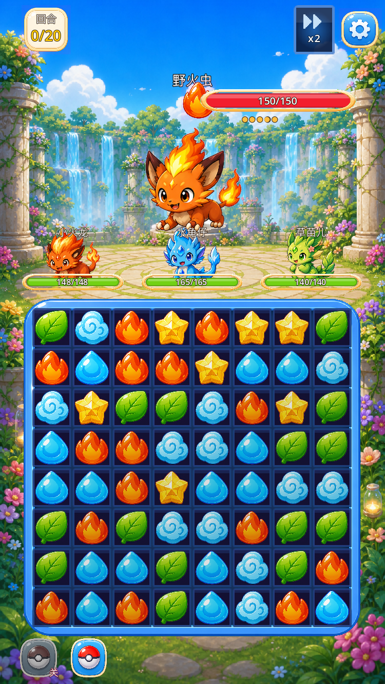

# 震动反馈层：四类事件、可测计数

本轮把设置页里原本空置的 `vibrationOn` 接到四类事件：技能释放、战斗胜利、战斗失败、按钮点击。
所有档位集中在 `src/ui/components/vibration_feedback.gd` 的 `CONFIG`；`enabled` 是总开关，
每帧同步设置页，运行中切换下一帧生效。桌面/headless 没有马达时 `Input.vibrate_handheld()`
是空操作，但请求仍会累计到计数器，因此可以逐次断言。

## 对比口径

- 基线：`6f33d41`（PR #17 合并后的 main）。
- 改动后：`agent/vibration-feedback-797f551f8155` 分支。
- 运行环境：Godot `4.7.2.stable`，macOS Apple M1。
- 画面口径：`stage_1_1`、750×1334 窗口（375×667 逻辑视口）、默认主题、同一截图 harness。
- 原始输出口径：固定战局 `stage_1_1`、seed `20261109`、20 回合脚本；同时关闭 `soundOn` / `musicOn` 以隔离音频层。
- 计数口径：一次 `request(event_id)` 记 1 次请求；总开关关闭或事件未配置时记 1 次丢弃。

## 四类档位

`CONFIG.profiles` 的四类档位两两之间强度与时长都不同（至少两项参数不同）：

| 事件 | label | strength | duration_ms | 触发点 |
| --- | --- | --- | --- | --- |
| `skill_cast` | 技能释放 | `0.60` | `40` | 战斗场景技能释放成功后（`_apply_skill_result_visuals`） |
| `victory` | 战斗胜利 | `0.90` | `160` | 战斗结算 `battle_result == "win"`（`_begin_battle_end_overlay`） |
| `defeat` | 战斗失败 | `0.75` | `240` | 战斗结算非胜利（`_begin_battle_end_overlay`） |
| `button_tap` | 按钮点击 | `0.30` | `18` | 场景原生 `BaseButton` 统一接线；设置/战斗/队伍/成就/签到/教程自绘按钮在点击处显式调用 |

总开关默认值 `CONFIG.enabled = true`，设置页缺 `vibrationOn` 时沿用该默认值。

## 开关两态原始输出

| 状态 | `enabled` | `request_count` | `dropped_count` | 四类事件计数 |
| --- | --- | --- | --- | --- |
| `vibrationOn=true` | `true` | `4` | `0` | `skill_cast=1, victory=1, defeat=1, button_tap=1` |
| `vibrationOn=false` | `false` | `0` | `4` | 四类均为 `0` |

真实战斗场景中按顺序触发：技能释放 → 底栏自动捕捉按钮 → 胜利 → 失败。每类在开启时恰好 1 次请求；
关闭时四类全部进入丢弃，请求数恒 0。

原始文件：

- `vibration_on.txt`：`vibrationOn=true` 的完整 `raw_json`（含四类计数、档位与固定战局）。
- `vibration_off.txt`：`vibrationOn=false` 的完整 `raw_json`。
- `test_output.txt`：`vibration_feedback_test` 完整输出。

关键 JSON：

```json
// vibration_on.txt
"vibration": {
  "dropped_count": 0,
  "enabled": true,
  "event_counts": {"button_tap": 1, "defeat": 1, "skill_cast": 1, "victory": 1},
  "last_duration_ms": 240,
  "last_event": "defeat",
  "last_strength": 0.75,
  "request_count": 4
}

// vibration_off.txt
"vibration": {
  "dropped_count": 4,
  "enabled": false,
  "event_counts": {"button_tap": 0, "defeat": 0, "skill_cast": 0, "victory": 0},
  "last_duration_ms": 0,
  "last_event": "",
  "last_strength": 0.0,
  "request_count": 0
}
```

## 空跑 2 秒

无按钮、无事件的空跑 2 秒，计数器保持：

```text
[Vibration] idle 2s requests=0 dropped=0
```

## 运行中切换

`VibrationFeedback` 作为 Autoload 每帧读取 `SaveManager.load_settings()` 并同步总开关：

- 关闭后下一帧 `enabled=false`，之后的 `request()` 全部计入丢弃；
- 重新打开后下一帧 `enabled=true`，请求恢复；
- 切换过程不重建场景，也不影响战斗状态。

## 按钮接线范围

- 所有场景原生 `BaseButton`（`TextureButton` / `Button`）：由 `main.gd` 在场景初始化后统一调用
  `VibrationFeedback.wire_buttons()`，同一按钮重复接线不会重复计数。
- 自绘按钮：设置页的返回 / 重置 / 恢复默认 / 确认弹窗 / 开关行 / 分段选择，
  战斗底栏的自动捕捉开关与道具格，以及队伍页、成就页、签到页、教程页的按钮，
  在点击命中处显式 `request("button_tap")`。

## 战斗日志与结算 JSON

同一固定种子、同一脚本分别跑 `vibrationOn=true` 与 `vibrationOn=false`：

- `turns`、`damage_dealt_log`、`damage_taken_log`、`result` 四个字段 JSON 逐位一致（`identical=true`）；
- 固定战局结果均为 `win`、4 回合、12 条伤害日志、3 条承伤日志；
- 震动层不消耗全局随机数，也不参与伤害/血量计算。

## 四条平衡线

在基线 `6f33d41` 与改动后分支分别运行：

- `combat_balance_test`（含既有分档门槛）
- `boss_break_test`
- `stun_order_test`
- `battle_rules_test`（既有战斗规则/阈值）

`balance_lines_before.txt` 与 `balance_lines_after.txt` 逐字节一致（`diff -q` 无输出），
四条平衡线输出与基线相同。证据文件只保留测试自身的 `[...]` 输出行，过滤掉 Godot 引擎
banner 与退出清理告警（后者偶发出现、与平衡数值无关）。

## 战斗截图

同一 `stage_1_1` 首屏、同一截图 harness、默认主题、750×1334 视口：

| 基线 `6f33d41` | 改动后分支 |
| --- | --- |
|  |  |

本轮只增加震动行为，没有改 UI；两态截图画面一致。受棋盘闲置动画相位影响，逐像素存在
约 1.6% 的微差（画面内容相同），视觉与布局无差异。

```bash
GODOT=~/Applications/Godot.app/Contents/MacOS/Godot
$GODOT --path . --script res://tests/capture_runtime_scene.gd -- \
  --scene-name=battle --stage-id=stage_1_1 --hide-toast=1 --settle-frames=6 \
  --output=docs/evidence/vibration_feedback/after_battle.png
```

## 测试

```bash
GODOT=~/Applications/Godot.app/Contents/MacOS/Godot

# 本轮新增回归
$GODOT --headless --path . --script res://tests/vibration_feedback_test.gd

# 两态原始输出
$GODOT --headless --path . --script res://tests/vibration_feedback_test.gd -- --vibration-state=on  > vibration_on.txt
$GODOT --headless --path . --script res://tests/vibration_feedback_test.gd -- --vibration-state=off > vibration_off.txt
```

本轮跑过的回归（全部 exit 0）：

`vibration_feedback_test`、`combat_balance_test`、`boss_break_test`、`stun_order_test`、
`battle_rules_test`、`p0_contract_test`、`p0_smoke_test`、`battle_bgm_test`、`battle_sfx_test`、
`battle_gui_scene_test`、`battle_prepare_result_gui_scene_test`、`battle_input_test`、
`battle_result_stats_test`、`active_skill_test`、`main_lobby_scene_test`、`start_gui_scene_test`、
`stage_select_gui_scene_test`、`inventory_gui_scene_test`、`shop_gui_scene_test`、
`ranch_gui_scene_test`、`album_gui_scene_test`、`stage_progress_loop_test`、`damage_numbers_test`、
`combo_chain_test`、`enemy_attack_modes_test`、`enemy_windup_test`、`enemy_intent_test`、
`wave_entry_test`、`p1_ch1_slice_test`、`chapter_mechanic_test`、`battle_hit_reaction_test`、
`team_transition_test`、`tutorial_flow_test`、`team_ui_polish_test`、`capture_auto_item_test`、
`reward_rules_test`。

## 约束核对

- 未改动 `src/data`：本 PR 对 `src/data` 零 diff。
- 未改动伤害/血量与四条平衡线：`combat_balance_test`、`boss_break_test`、`stun_order_test`、
  `battle_rules_test` 输出与 `6f33d41` 逐字节一致。
- 未改动既有 `battle_sfx` / `combo_sfx` / `battle_bgm` / 飘字 / 命中反馈 / 受击反应参数；
  `battle_sfx_test`、`battle_bgm_test`、`battle_hit_reaction` 相关回归均通过。
- 仓库未进入任何二进制素材：新增文件只有 `.gd`、测试、文本证据与截图。
